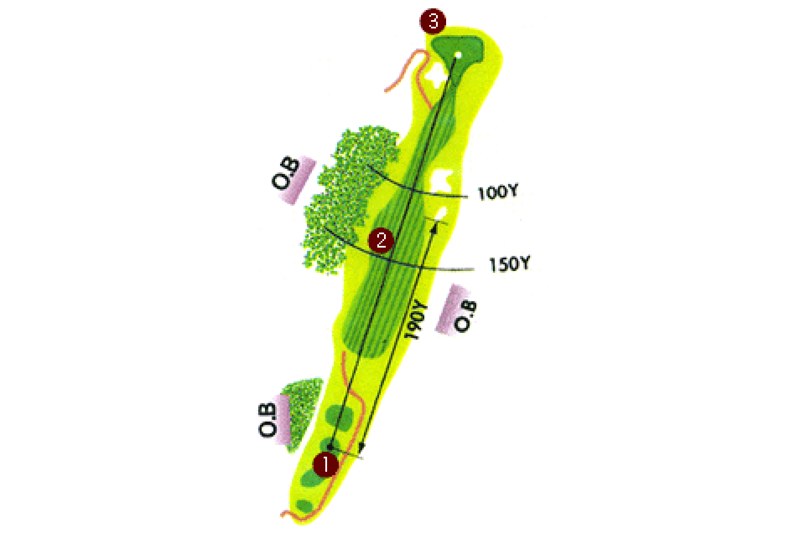
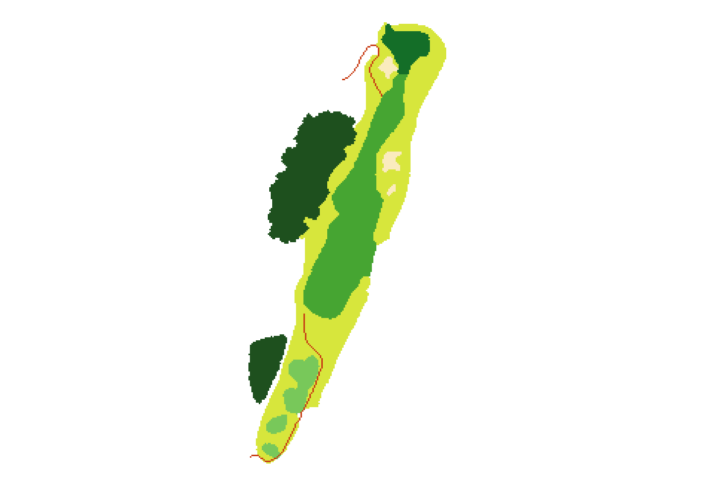
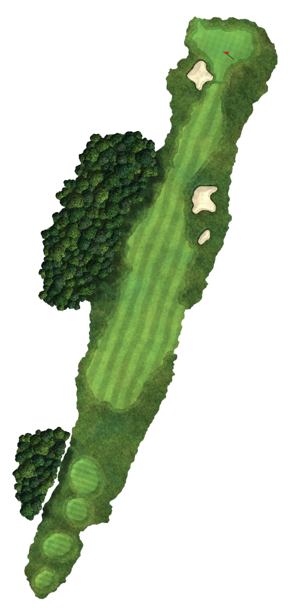
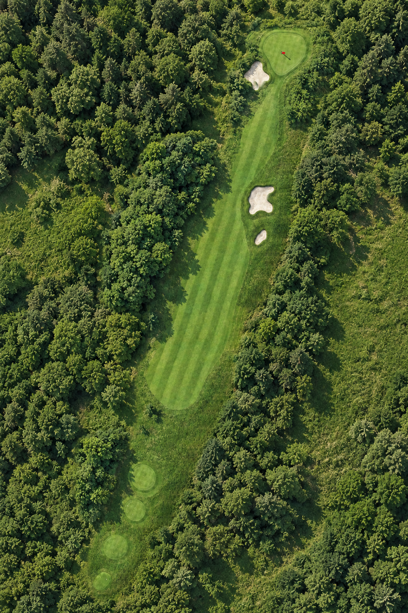

# golf-course-photoreal

ゴルフ場のコースレイアウト図（イラスト）から、記号を消して領域を確定し、レイアウトを崩さずに航空写真風の画像を作るパイプライン。

| 元のレイアウト図 | 領域マップ | ローカル描画 (v2) | 写真調＋周囲の森 (最終) |
|---|---|---|---|
|  |  |  |  |

## 流れ

1. **`pipeline/segment.py`**：元GIF（480×321）を色のルールで分類します（ラフ、緑系、カート道、OB札、白、その他の記号）。白のうち画像の外周につながる部分は背景、内側に閉じた白い島はバンカー候補として扱います。
2. **`pipeline/labels.py`**：意味のあるラベルに変換し、記号を除去します。
   - 木：指定した範囲の中にある、まだら模様の大きな緑の塊を拾います。
   - 番号の丸、距離の線、文字、OB札：未定義の画素として扱い、距離変換で一番近いラベルの値を入れて埋めます。
   - フェアウェイ：細いヤード線を消すため、モルフォロジーの opening を1回かけます。
   - グリーンは上端の領域、ティーは下端の楕円として分けます。
3. **`pipeline/render.py`**（v1）と **`pipeline/render2.py`**（v2、カート道なし）：10倍に拡大して描画します。
   - クラスごとにぼかしたマスクを作り、どのクラスの値が最大かで塗り分けて輪郭をなめらかにします。白黒マスクは `data/masks/` に出力します。
   - 高さマップを作ります（グリーンとティーは盛り上げ、バンカーは窪ませて縁を付ける）。それをバンプとして使い、左上からの光で陰影を付けます。
   - 芝は方向性のあるノイズで表現します。ほかに芝刈りの縞、ファーストカット、砂粒とレーキ跡、葉の塊を組み合わせた樹冠、木の影を描きます。
   - 境界は大きなスケールのドメインワープで自然な形にします。ティーとバンカーはワープの対象外にして形を保ちます。
4. **`postprocess.py pad`**：v2の描画を白背景で縦横比2:3に広げ、ChatGPTへの入力 `data/gen_input.png` を作ります。
5. **ChatGPT（画像生成）**：`gen_input.png` と参考の航空写真 `data/ref_aerial.png` を渡します。プロンプトは `prompts/prompt_photoreal.txt` で、レイアウトを固定し、コースの外は純白のままにするよう指示しています。結果は `data/gen/v3_photoreal_raw.png` です。
6. **`postprocess.py cutout`**：白背景を外周から塗りつぶして切り抜き、`golf_photoreal_cutout.png` を出力します。元マスクと外形を比べたIoUは **0.96** です。
7. **ChatGPT**：v3と参考写真を渡し、白い部分を森と草地で埋めるよう指示します。プロンプトは `prompts/prompt_surround.txt`、結果は `data/gen/v4_surround_raw.png` です。
8. **`postprocess.py scene`**：生成された背景ではホールの位置が少しずれます（実測で約12px）。ECC（アフィン変換）で位置を合わせ、v3のホールを縁をぼかして上に重ねます。これでレイアウトは v3 と同じものになります。出力は `golf_photoreal_scene.png` です。

## 実行

```bash
python -m venv .venv && . .venv/bin/activate
pip install -r requirements.txt
python pipeline/segment.py
python pipeline/labels.py
python pipeline/render2.py          # or render.py (v1, with cart path)
python pipeline/postprocess.py pad
# -> gen_input.png + ref_aerial.png + prompts/prompt_photoreal.txt を ChatGPT へ、結果を data/gen/v3_photoreal_raw.png に
python pipeline/postprocess.py cutout
# -> gen_v3.png + ref_aerial.png + prompts/prompt_surround.txt を ChatGPT へ、結果を data/gen/v4_surround_raw.png に
python pipeline/postprocess.py scene
```

スクリプトはすべて `data/` を作業ディレクトリとして読み書きします。ChatGPT への送信は opengpt（ChatGPTをCLIから操作する自作ツール） の `send --image a.png,b.png --save-images ./gen` で行いました。ChatGPT の画面に手動で画像を貼り付けても同じことができます。

## ハマりどころ

- 番号の丸を塗りつぶしたときに、隣り合うティー2つがつながってしまいました。そのためティーは楕円で引き直しています（`render2.py` の `TEES`）。
- 細かいドメインワープ（スケール8px程度）をかけると、輪郭が虫食いのようになってラフとフェアウェイの境目が消えます。使うのは大きなスケールのワープだけにしました。
- 木の塊の中の隙間にアルベド（地の色）を設定しないと、そこが黒く抜けます。
- 合成の後で白い点を消す処理を画像全体にかけると、バンカーのハイライトまで消えてしまいます。処理する範囲を限定してください。
- 高さマップや法線マップなどの分析用マップは ChatGPT に送っていません。送ったのは描画結果と参考写真だけです。

## 画像について

`data/src.gif`（元のコースレイアウト図）と `data/ref_aerial.png`（参考の航空写真）は、外部から入手した画像です。
